  

  
  
  
  
  

## Hello, and welcome

I'm a biotechnology researcher who builds software. I take a biological question, turn it into a computational workflow, and try to make every step of that workflow something another researcher can inspect, test and improve.

I'm doing an **MSc in Biotechnology (Industrial Biotechnology)** at **Gujarat Biotechnology University**. My work so far covers CRISPR guide design, machine learning for fermentation, structural bioinformatics and, right now, the search for phage enzymes that kill drug-resistant bacteria.

  

## What I'm working on now

**Endolysins against ESKAPE pathogens - my MSc dissertation** (Oct 2026 - Jun 2027, supervised by Dr. Dhaval Patel)

Endolysins are enzymes that bacteriophages use to break open bacterial cell walls, which makes them a promising alternative to antibiotics. I'm mining public metagenomic datasets for new ones and ranking the best candidates against six drug-resistant hospital pathogens.

- **Find** - build a curated, non-redundant set of phage proteins from metagenomes
- **Detect** - pick out endolysins with protein language models, checked against domain search
- **Match** - predict which bacteria each endolysin's phage infects
- **Rank** - shortlist 10 to 20 candidates using sequence, structure and docking evidence

## A small demo of what my CRISPR tools do

  

Scan a sequence, find every NGG site, and surface the 20-nucleotide guide beside it. The real tools add ranking, specificity checks and a record of where every sequence came from.

## Featured projects

<table>
<tr>
<td width="50%" valign="top">

### [Plant MultiGene gRNA Designer](https://github.com/abdulbasitbehlim/Plant-MultiGene-gRNA-Designer)

Finds **one SpCas9 guide that targets several homologous plant genes**, with mismatch-aware consensus design, per-gene evidence and explicit PASS / REVIEW / FAIL validation.

[Open the app](https://plant-multigene-grna-designer.onrender.com/) · [Source](https://github.com/abdulbasitbehlim/Plant-MultiGene-gRNA-Designer)

`Python` `Streamlit` `Biopython` `CRISPR` `Plant genomics`

</td>
<td width="50%" valign="top">

### [OpenCRISPR-1 gRNA Designer](https://github.com/abdulbasitbehlim/OpenCRISPR1-gRNA-Designer)

A careful guide-design workbench for **OpenCRISPR-1**: both-strand NGG scanning, guide-format review, quality ranking and local specificity screening.

[Open the app](https://opencrispr1-grna-designer.onrender.com/) · [Source](https://github.com/abdulbasitbehlim/OpenCRISPR1-gRNA-Designer)

`Python` `Streamlit` `Biopython` `CRISPR` `Validation`

</td>
</tr>
<tr>
<td width="50%" valign="top">

### [IndPenSim Penicillin Soft Sensor](https://github.com/abdulbasitbehlim/IndPenSim-penicillin-soft-sensor)

A machine-learning soft sensor that estimates penicillin concentration during fermentation, **including batches where something goes wrong**. Batch-wise validation, uncertainty and out-of-distribution detection.

[Read the preprint](https://doi.org/10.64898/2026.09.21.753176) · [Repository](https://github.com/abdulbasitbehlim/IndPenSim-penicillin-soft-sensor)

`Python` `Machine learning` `Bioprocessing` `OOD detection`

</td>
<td width="50%" valign="top">

### [CRISPR Studio - gRNA Designer](https://github.com/abdulbasitbehlim/CRISPR-gRNA-Designer)

A general SpCas9 and CRISPRi design workbench with NCBI and Ensembl sequence lookup, transparent guide ranking and local off-target screening.

[Open the app](https://crispr-grna-designer-v6mhgxd4o3eqbhgur3anvh.streamlit.app/) · [Source](https://github.com/abdulbasitbehlim/CRISPR-gRNA-Designer)

`Python` `Streamlit` `CRISPRi` `NCBI` `Ensembl`

</td>
</tr>
</table>

**More:** [AMS Venom Diagnostic Dashboard](https://github.com/abdulbasitbehlim/AMS-Venom-Diagnostic-Dashboard), an interactive simulation of antigen-scFv diagnostic signals · [Basit Hub](https://abdulbasitbehlim.github.io/basit-hub/) ([code](https://github.com/abdulbasitbehlim/basit-hub)), my research start page with a 3D protein of the day and database search · [all repositories](https://github.com/abdulbasitbehlim?tab=repositories)

## Research areas

| Area | What I do in it |
|---|---|
| **Phage and microbial bioinformatics** | Endolysin discovery, phage protein annotation, host prediction, protein language models |
| **Genome engineering** | CRISPR guide design, multi-gene targeting, validation, sequence provenance |
| **Bioprocess data science** | Soft sensors, fault-inclusive modelling, uncertainty, out-of-distribution analysis |
| **Structural bioinformatics** | Protein structure analysis, molecular docking, molecular dynamics |
| **Scientific software** | Python tools, Streamlit apps, reproducible pipelines |

## Toolkit

| | |
|---|---|
| **Core** | `Python` `Git` `GitHub` `Linux` `Docker` `VS Code` |
| **Data and machine learning** | `NumPy` `Pandas` `SciPy` `scikit-learn` `Matplotlib` `Plotly` `Jupyter` |
| **Bioinformatics** | `Biopython` `HMMER` `NCBI` `Ensembl` `Streamlit` |
| **Structural biology** | `ChimeraX` `Schrödinger Glide` `HADDOCK` `AlphaFold / ESMFold` |
| **Web and testing** | `HTML` `CSS` `JavaScript` `Pytest` `GitHub Actions` |

## Research snapshot

| | |
|---|---|
| **Education** | MSc Biotechnology (Industrial Biotechnology), Gujarat Biotechnology University |
| **National examinations** | GAT-B 2025, All India Rank 62 · CSIR-UGC NET, June 2026 · IIT JAM 2025, All India Rank 875 |
| **Fellowship** | GAT-B National Fellowship, Department of Biotechnology, Government of India |
| **Preprint** | [Fault-inclusive soft sensing of penicillin concentration](https://doi.org/10.64898/2026.09.21.753176), bioRxiv, 2026 |
| **Research experience** | Structure-based study of human β-cardiac myosin inhibitors, IIT Roorkee |
| **Recognition** | Best Student of the Year (2022-24), MBSI with HiMedia Laboratories |

## How I approach scientific software

- **Biologically grounded** - assumptions and limitations are stated clearly
- **Reproducible** - versions, provenance, benchmark inputs and tests are kept
- **Interpretable** - outputs come with the context needed to judge them
- **Usable** - researchers can run a workflow through a practical interface and export the results
- **Open to validation** - a computational prediction is evidence to investigate, not a substitute for an experiment

## Connect

I'm interested in research collaborations where biotechnology, computational biology and practical scientific software meet. If you have a biological question worth building on, write to me.

  
  
  

  

  

